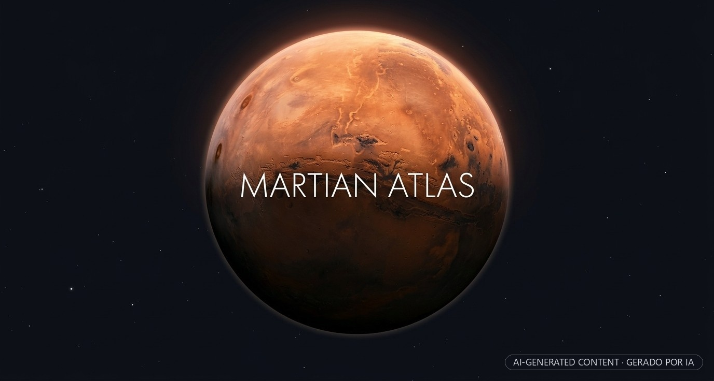
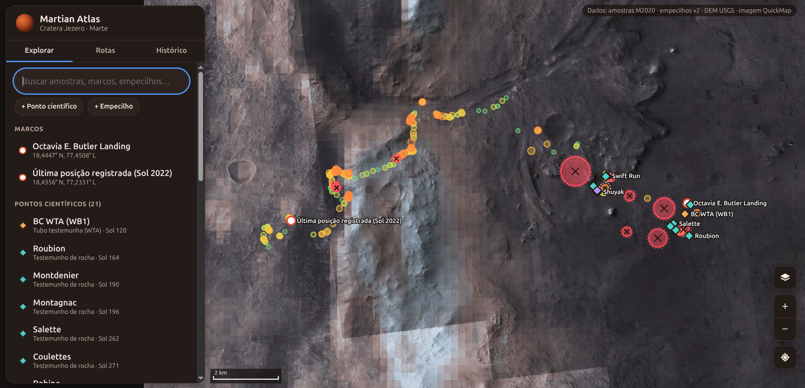

# Martian Atlas

<div align="center">
  
</div>

A web navigation and cartography system for **Jezero Crater**, the landing site of NASA's Mars 2020 _Perseverance_ rover (≈ 18.44° N, 77.45° E). It combines open elevation data, orbital imagery, science samples and a catalog of **mapped hazards** to compute safe rover routes automatically, and reroutes in real time when an explorer reports a new hazard.

<div align="center">
  
</div>

## Table of Contents

- [Overview](#overview)
- [Validation with a NASA Mentor](#validation-with-a-nasa-mentor)
- [Features](#features)
- [How the Routing Engine Works](#how-the-routing-engine-works)
- [Data and ETL Pipeline](#data-and-etl-pipeline)
- [Technologies Used](#technologies-used)
- [Getting Started](#getting-started)
- [Project Structure](#project-structure)
- [Sources and References](#sources-and-references)
- [Use of Artificial Intelligence](#use-of-artificial-intelligence)
- [Contributors](#contributors)

## Overview

**The problem.** Planetary portals such as NASA Mars Trek and the Planetary Data System (PDS) hold excellent global Mars data: orbital images, MOLA altimetry and rover telemetry. But specialists must cross-reference all of it by hand to plan a traverse. Perseverance's **AutoNav** avoids rocks only locally, in real time. There is **no public, unified and structured database of historical obstacles/incidents combined with collaborative routing**.

**The solution.** Martian Atlas turns open data into a layered navigation map:

- a Digital Elevation Model (DEM) for slope and terrain cost;
- a georeferenced HiRISE orbital mosaic as the base map;
- 21 real science sample sites collected by Perseverance, each with its photo;
- 325 hazards (craters, sand traps, steep slopes, boulder fields, rough terrain) rated on a **criticality scale from 1 to 5**.

Routes are computed with **A\*** over a cost grid. If an explorer meets a surprise hazard on the way, they report it and the active route is **recomputed immediately**, Waze-style.

## Validation with a NASA Mentor

During the hackathon we asked a NASA mentor, in the open forum:

Mars Surface Datasets & Obstacle Logging- Interplanetary Survival Guide: https://github.com/nasa/spaceapps/discussions/2168

1. _Does NASA currently have an existing system for logging surface incidents/obstacles and using that historical data for route planning on Mars?_
2. _Are there any open datasets or specific tools (like Mars Trek or rover path logs) that you recommend we use as a base?_

The mentor explained that NASA relies on **AutoNav** and the stereo **Hazcams** to build local 3D maps and avoid rocks, plus tools such as **NASA Mars Trek**, the **Analyst's Notebook** and the traverse **Location Maps**. The key confirmation:

> _"NASA's public archives provide camera data, mission records and traverse information, but I could not verify a single public database containing every obstacle encounter and avoidance decision as ready-to-use structured records. Your team may therefore need to build its own annotated obstacle log from these sources."_

The mentor suggested the approach we implemented: build a structured obstacle database, combine it with elevation/terrain layers, and score candidate paths by terrain difficulty and identified hazards.

## Features

### 1. Application Features

| Feature | Category | Data Inputs Used | Description |
| :--- | :--- | :--- | :--- |
| **Interactive Layered GIS Map** | Cartography & Visualization | Raster (HiRISE, DEM) + Vector | Pan/zoom across Jezero Crater (≈ 26 × 24 km) limited to the imaged bounds. Toggle satellite base map, relief (DEM), slope heatmap, hazards, and science samples. |
| **Multi-Stop Route Planner** | Spatial Optimization | Quantitative + Qualitative | Computes paths across `Origin → Intermediate Waypoints → Destination`, reporting total distance (km), drive time (hours), and Martian Sols. |
| **Up to 3 Route Alternatives** | Decision Support | Quantitative Cost Grid | Generates up to 3 distinct candidate paths (*fastest*, *shortest*, *least exposed*); candidates overlapping >60% with an existing route are discarded. |
| **Topographic Elevation Profile** | Terrain Analysis | Quantitative Continuous | Interactive chart displaying elevation (m) and local slope (°) along the selected route. |
| **Live Traverse Tracking** | Telemetry Simulation | Quantitative Continuous | Simulates rover movement along the active route with real-time remaining distance and time, pause/stop controls, and history saved in `localStorage`. |
| **Surprise Hazard Reporting ("Waze")** | Collaborative Logging | Qualitative + Quantitative | Register a new obstacle (criticality 1–5) anywhere on the map; if it blocks the active traverse, the engine immediately recalculates a safe detour. |
| **Explore Catalog & Photo Previews** | Science & Hazard Inspection | Qualitative + Media | Lists all science samples and grouped hazards. Hovering or clicking displays real Sol sample photos or criticality-matched illustrative Hazcam scenes. |

### 2. Data Model Features (Variable & Statistical Classification)

| Feature / Column | Dataset | Statistical Data Type | Unit / Domain | Role in Routing & Visualization |
| :--- | :--- | :--- | :--- | :--- |
| `lat`, `lon` | Hazards & Samples | **Quantitative Continuous** | Degrees (`°N`, `°E`) | Planetocentric geographic coordinates in Jezero Crater. |
| `easting`, `northing` | Samples & Grid | **Quantitative Continuous** | Meters (`m`) | Equirectangular projected coordinates (standard parallel 18.4663° N). |
| `elevation_m` | DEM & Hazards | **Quantitative Continuous** | Meters (`m`) | Elevation relative to the Martian areoid (MOLA datum); drives slope calculation. |
| `slope_deg` | DEM & Hazards | **Quantitative Continuous** | Degrees (`0°–90°`) | Local terrain inclination (IMU tilt or DEM gradient); penalizes cost and blocks >25°. |
| `radius_meters` | Hazards | **Quantitative Continuous** | Meters (`m`) | Physical footprint radius of the crater, sand trap, scarp, or boulder field. |
| `severity_score` | Hazards | **Quantitative Continuous** | Normalized (`0.0–1.0`) | Continuous hazard intensity weight used in the cell cost multiplier (`1 + 4 · severity`). |
| `criticality_level` | Hazards | **Qualitative Ordinal** | Scale (`1` to `5`) | Risk rank from `1` (Very Low) to `5` (Critical/Impassable); defines safety buffer size (10–50 m) and UI color. |
| `sol` | Samples & Waypoints | **Quantitative Discrete** | Integer (`Sol 0+`) | Martian solar day when the sample was cached or the rover waypoint was recorded. |
| `obstacle_type` | Hazards | **Qualitative Nominal** | Category (`crater`, `sand_trap`, `steep_slope`, `boulder_field`, `rough_terrain`) | Geological/terrain classification of the obstacle. |
| `passable_by_rover` | Hazards | **Qualitative Nominal (Binary)** | Boolean (`True` / `False`) | Determines whether the hazard is strictly blocked or traversable with a penalty. |
| `is_dynamic_report` | Hazards | **Qualitative Nominal (Binary)** | Boolean (`True` / `False`) | Distinguishes historical ETL hazards (`False`) from live user-reported Waze hazards (`True`). |
| `sample_id` / `obstacle_id` | Samples & Hazards | **Qualitative Nominal** | String ID (`M2020-SSSSS-NN`) | Unique primary identifier for traceability and logging. |

## How the Routing Engine Works

Code: `js/core/world.js`, `pathfinding.js`, `route.js`, `traverse.js`.

To find the safest and most efficient path between two or more points on Mars, the application uses the **A\* (A-Star) pathfinding algorithm** in four simple steps:

1. **50 m Terrain Cost Grid (`world.js`):**
   We divide the Jezero Crater map into a grid of 50 m × 50 m cells (518 × 474 cells) and assign a "difficulty score" (cost) to each cell:
   - **Impassable Hazards (`passable_by_rover = False`):** Craters, sand traps, and cliffs completely **block** the cells inside their radius plus a safety margin based on criticality (from 10 m at level 1 up to 50 m at level 5).
   - **Passable Hazards (`passable_by_rover = True`):** Rough terrain and moderate boulder fields remain open, but increase the cell cost (`1 + 4 · severity_score`), encouraging the rover to go around them when possible.
   - **Terrain Slope (DEM):** Steeper ground costs more to climb (`1 + 0.5 · (slope / 8°)²`), and any slope above **25°** is automatically blocked for rover safety.
2. **Finding the Best Path with 8-Connected A\* (`pathfinding.js`):**
   The **A\* algorithm** searches the grid (allowing vertical, horizontal, and diagonal moves) by combining the **actual terrain cost traveled so far** with the **estimated straight-line distance to the goal**. This guarantees finding the path with the lowest total risk and effort much faster than searching blindly in all directions. Afterward, a **line-of-sight smoothing** step straightens out grid zig-zags without cutting across blocked zones.
3. **Generating Up to 3 Route Alternatives (`route.js`):**
   Once the best route is found, the engine temporarily increases the cost (×3) along a 200 m corridor around that path and runs **A\*** again. This produces up to **3 distinct options** (*fastest*, *shortest*, and *least exposed*). Any alternative that repeats more than 60% of an existing route is discarded.
4. **Drive Time & Live "Waze" Rerouting (`traverse.js`):**
   - **Time Estimate:** Calculated from a base rover speed of **~150 m/h** (slowed down proportionally on rougher cells), assuming **4.5 driving hours per Martian Sol**.
   - **Dynamic Rerouting:** If a user reports a new hazard on the map that blocks the active route, the cost grid updates immediately and **A\*** recalculates a new detour from the rover's current position.

## Data and ETL Pipeline

All data lives in `data/`.

### Hazards — `data/jezero_obstacles_v2_clean.csv`

We built an ETL pipeline (`etl_obstacles.py` / `run_etl.ps1`, run offline; the scripts are not part of this repository) that produces **325 hazards** from two complementary sources:

1. **In-situ telemetry — NASA MMGIS waypoints** (`M20_waypoints.json`, 708 real Perseverance stops). We kept every stop where the rover's IMU recorded a chassis **tilt ≥ 8.0°**, which gives **315 terrain hazards**:
   - `8.0° ≤ tilt < 15.0°` → `rough_terrain`
   - `tilt ≥ 15.0°` → `steep_slope`
2. **Orbital mapping — USGS / HiRISE / AI4Mars terrain classes.** Rover telemetry only records where the rover _could_ drive, so we added the **10 major blocking/risk zones** it must go around:
   - **Craters** (`crater`): Belva (450 m radius), Santa Cruz (180 m), Lahontan (95 m).
   - **Sand traps / dunes** (`sand_trap`): Séítah North (320 m) and South (280 m).
   - **Steep scarps** (`steep_slope`): Delta front / Cape Nukshak (28°), Kodiak Butte (32°).
   - **Boulder fields** (`boulder_field`): Three Forks and the Margin Unit.

Schema: `obstacle_id`, `name`, `source_dataset`, `lat`, `lon`, `elevation_m`, `obstacle_type`, `radius_meters`, `slope_deg`, `severity_score` (0.0–1.0), `criticality_level` (1–5), `passable_by_rover`, `is_dynamic_report`, `description`.

### Science samples — `data/M2020_amostras_armazenadas.csv` + `data/samples/*.jpg`

The **21 real samples** collected and cached by Perseverance: `sample_id` (`M2020-SSSSS-NN`), Sol, `lat`/`lon` and projected `easting`/`northing`. Each sample has a photo from the Mars 2020 raw image archive, named by Sol (e.g. `data/samples/164.jpg`).

### Hazard photos — `data/obstacles/c<level>-<n>.jpg`

22 Hazcam frames from the Mars 2020 raw image archive, grouped by visual criticality (1 = smooth ground … 5 = large rocks / steep terrain). They are **illustrative**: each hazard deterministically picks one photo of its own criticality level; the photo is not of that exact hazard.

### Elevation & Topography
* **Dataset:** USGS Mars HRSC–MOLA Blended DEM (`relevo`, ~1.8 GB).
* **Processing:** Integrated into QGIS 3D Viewport with optimized vertical scaling and border skirts (`skirt depth = 50–100`) to prevent rendering gaps. Combined with automated hillshade analysis to highlight crater rims, slopes, and topological features.

### Base Map & Tactical Export
* **Dataset:** HiRISE High-Resolution Orthomosaic (`textura`, ~25 GB) fused with official NASA Mars Trek / USGS color layers.
* **Processing:** Optimized via pyramid generation and Bilinear/Cubic resampling to eliminate 2D blurriness. Blended using QGIS render modes (`Sobrepor` / `Multiplicar`) with adjusted global opacity to merge ultra-sharp surface details with geological colorization and topographic shading.
* **Georeferencing & GPS Integration:** Exported as a high-resolution georeferenced tactical map paired with a World File (`.wld` / `.pgw`), defining the exact navigation bounds (77.152°–77.612° E, 18.289°–18.688° N) for direct deployment on external GPS hardware.

## Technologies Used

- **JavaScript (ES Modules)**, no framework and no runtime dependencies
- **HTML5 Canvas** and **CSS3**
- **Node.js 20+** for the static dev server (`scripts/serve.js`) and the test runner (`node --test`, 20 tests)
- **Python** (offline): pandas for the hazard ETL; OpenCV and Pillow for image registration and conversion
- **QGIS** for 3D terrain modeling, raster pyramid optimization, hillshade analysis, layer blending, and georeferenced tactical map exports with World Files (`.wld` / `.pgw`)
- **Geospatial Datasets**: USGS Mars HRSC–MOLA Blended DEM (~1.8 GB) and HiRISE High-Resolution Orthomosaic (~25 GB, bounds: 77.152°–77.612° E, 18.289°–18.688° N)

## Getting Started

Requires Node.js 20 or newer. ES modules do not load from `file://`, so the site needs the bundled HTTP server.

```bash
git clone https://github.com/Sl3nc/Martian_Atlas.git
cd Martian_Atlas
npm start        # http://127.0.0.1:8080 (override with PORT=xxxx)
npm test         # runs the 20 automated tests
```

## Project Structure

```
css/            styles
data/           DEM, base map, hazards, samples and photos
js/core/        geo projection, cost grid, A*, routes, traverse simulation
js/model/       CSV parsing, hazard and sample models
js/ui/          map canvas, terrain renderer, elevation profile, templates, storage
js/app.js       application wiring
scripts/        static dev server
tests/          node:test suites
```

## Sources and References

### Mars 2020 (Perseverance) location, telemetry and images

1. Perseverance Location Map (NASA): https://science.nasa.gov/mission/mars-2020-perseverance/location-map/
2. Curiosity Location Map (reference suggested by the mentor): https://science.nasa.gov/mission/msl-curiosity/location-map/
3. NASA MMGIS GeoJSON layers for Mars 2020:
   - Waypoints (708 stops with IMU `tilt`, `pitch`, `roll`, `elev_geoid`): https://mars.nasa.gov/mmgis-maps/M20/Layers/json/M20_waypoints.json
   - Traverse path: https://mars.nasa.gov/mmgis-maps/M20/Layers/json/M20_traverse.json
4. Mars 2020 Analyst's Notebook (PDS Geosciences Node, WUSTL): https://an.rsl.wustl.edu/m20/AN/an3.aspx — portal: https://an.rsl.wustl.edu/
5. Mars 2020 Perseverance Raw Images (sample and Hazcam photos): https://mars.nasa.gov/mars2020/multimedia/raw-images/

### PDS archives and autonomous navigation (AutoNav / Hazcams)

6. How Perseverance Drives on Mars (AutoNav): https://science.nasa.gov/resource/how-perseverance-drives-on-mars/
7. Perseverance rover components and Hazcams: https://science.nasa.gov/mission/mars-2020-perseverance/rover-components/
8. Mars 2020 Engineering Camera archive (PDS): https://pds.nasa.gov/ds-view/pds/viewBundle.jsp?identifier=urn:nasa:pds:mars2020_ecam&version=1.0
9. Curiosity Hazcam dataset (PDS): https://pds.nasa.gov/ds-view/pds/viewProfile.jsp?dsid=MSL-M-HAZCAM-2-EDR-V1.0

### Planetary cartography, elevation and nomenclature (NASA and USGS)

10. NASA Mars Trek (GIS viewer with MOLA, HiRISE and CTX layers): https://trek.nasa.gov/mars/ — WMTS API docs: https://trek.nasa.gov/tiles/apidoc/trekAPI.html?body=mars
11. Jezero HiRISE on NASA Mars Trek (high-definition black-and-white orbital imagery of Jezero Crater): https://trek.nasa.gov/mars/#v=0.1&x=77.01274065&y=17.675574349999998&z=7&p=urn%3Aogc%3Adef%3Acrs%3AEPSG%3A%3A104905&d=&locale=&b=mars&e=74.50511130224498%2C15.665076340627957%2C79.52036999775501%2C19.686072359372037&sfz=&w=
12. USGS Astrogeology Science Center: https://astrogeology.usgs.gov/
    - Mars HRSC–MOLA Blended DEM Global 200 m v2: https://astrogeology.usgs.gov/search/map/mars_mgs_mola_mex_hrsc_blended_dem_global_200m
    - Mars 2020 Terrain Relative Navigation HiRISE DTM Mosaic (detailed regional topography of the Jezero landing region, though with lower visual surface detail): https://astrogeology.usgs.gov/search/map/mars_2020_terrain_relative_navigation_hirise_dtm_mosaic#open
    - Mars Viking Colorized Global Mosaic 232m (colorized global mosaic of the Martian surface, providing broad color context but coarse/imprecise local details): https://astrogeology.usgs.gov/search/map/mars_viking_colorized_global_mosaic_232m
13. USGS Gazetteer of Planetary Nomenclature (Mars features and craters): https://planetarynames.wr.usgs.gov/Target/Mars

## Use of Artificial Intelligence

AI assistants supported the team throughout the project. Every result was reviewed, tested and validated by the team.

1. **Strategy and communication with mentors.** Translating and refining the English questions sent to NASA mentors, so the operations terms (_traverse planning_, _hazard avoidance_, _AutoNav_) were precise.
2. **Open-data discovery and ETL.** Locating the open NASA MMGIS endpoints (`M20_waypoints.json`) and structuring the ETL scripts (`etl_obstacles.py`, `run_etl.ps1`) that extract, clean and normalize the 325 Jezero hazards into the 1–5 criticality scale, combining Perseverance in-situ data with USGS/HiRISE/AI4Mars orbital features.
3. **Prototyping and implementation (Claude Code).** Help with the GIS interface, the cost-grid model (DEM slope + hazard blocking radius), A\* with line-of-sight smoothing, alternative routes and live rerouting. Also:
   - registering the HiRISE mosaic to geographic coordinates (SIFT feature matching) and limiting navigation to its extent;
   - converting and wiring the sample and Hazcam photos into the detail view and the map hover preview;
   - running the 20-test suite and checking each feature in a headless browser.
4. **Documentation.** Structuring the technical documentation and this README, and consolidating the NASA and USGS references.
